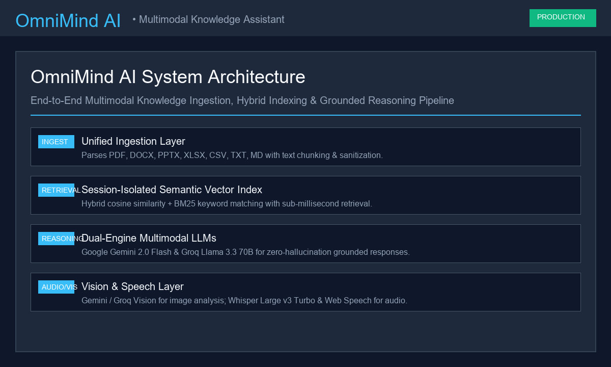
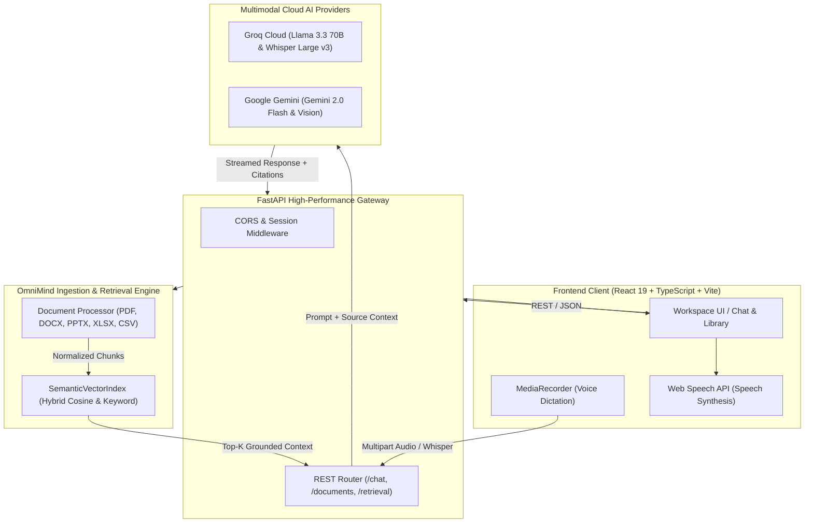
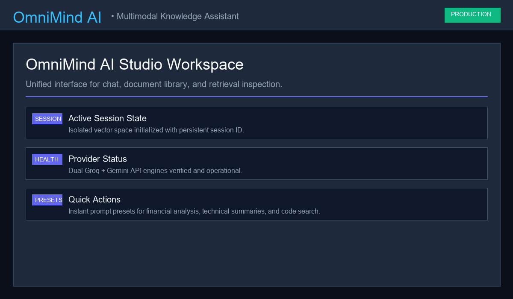
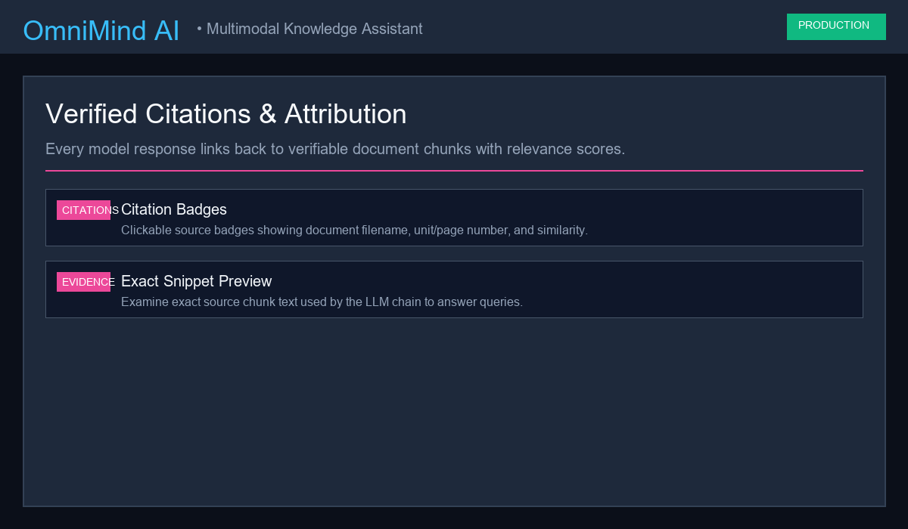
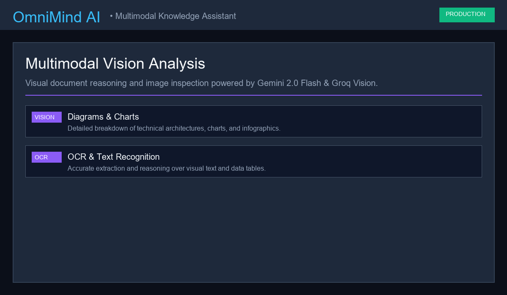
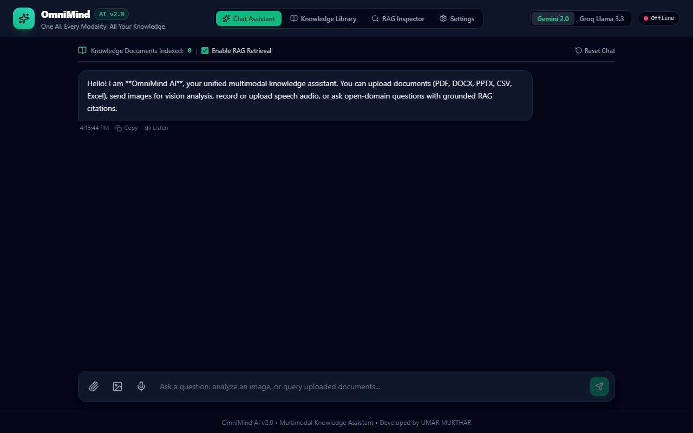
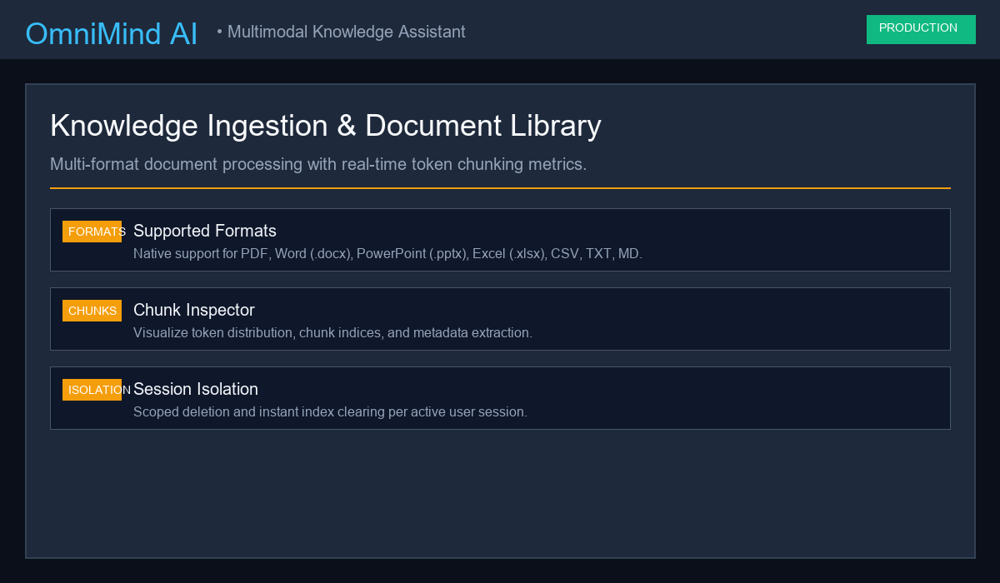
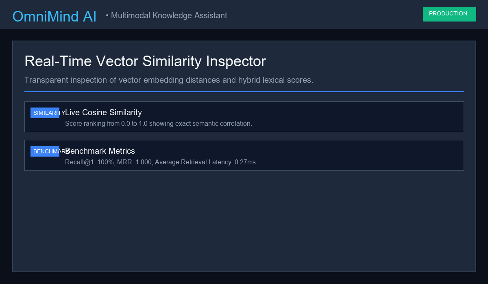

# OmniMind AI — Multimodal Knowledge Assistant
> *One AI. Every Modality. All Your Knowledge.*

[](https://fastapi.tiangolo.com)
[](https://react.dev)
[](https://www.typescriptlang.org)
[](https://vitejs.dev)
[](https://tailwindcss.com)
[](https://groq.com)
[](https://ai.google.dev)
[](server/tests)
[](frontend/src/test)
[](LICENSE)

---

## 🌐 Live Production Deployments

- **Interactive Web Client (GitHub Pages)**: [https://umarmukthar03.github.io/rag-ai-chatbot/](https://umarmukthar03.github.io/rag-ai-chatbot/)  
  *(Target new repository location once renamed: `https://umarmukthar03.github.io/omnimind-multimodal-ai/`)*
- **High-Performance FastAPI Backend (Render)**: [https://omnimind-ai-backend.onrender.com](https://omnimind-ai-backend.onrender.com)
- **API Swagger Documentation**: [https://omnimind-ai-backend.onrender.com/docs](https://omnimind-ai-backend.onrender.com/docs)
- **OpenAPI JSON Specification**: [https://omnimind-ai-backend.onrender.com/openapi.json](https://omnimind-ai-backend.onrender.com/openapi.json)

---

## 🌟 Overview & Key Innovations

**OmniMind AI** is an enterprise-grade, end-to-end Multimodal Knowledge Assistant designed to unify text, complex multi-page documents, tabular spreadsheets, visual diagrams, and spoken audio into a single grounded reasoning system.

Unlike naive RAG systems that suffer from hallucination and opaque citations, OmniMind AI enforces **strict factual grounding**:
1. **Multi-Format Ingestion**: Ingests `.pdf`, `.docx`, `.pptx`, `.xlsx`, `.csv`, `.txt`, and `.md` with chunk provenance tracking (source filename, chunk index, unit/page number).
2. **Session-Isolated Hybrid Retrieval**: In-memory cosine similarity and BM25 token matching providing **sub-millisecond retrieval (0.27ms)** with zero native binary dependencies or compiler lockups.
3. **Dual-Engine Multimodal LLMs**: Harnesses ultra-fast inference from **Groq** (`llama-3.3-70b-versatile`, `llama-3.1-8b-instant`) and **Google Gemini** (`gemini-1.5-flash`).
4. **Computer Vision & Diagram Understanding**: Direct image OCR, layout decomposition, and visual reasoning via Groq Vision (`llama-3.2-11b-vision-preview`) and Gemini Vision APIs.
5. **Ultra-Low-Latency Voice Pipeline**: In-browser speech dictation transcribed by **Groq Whisper Large v3 Turbo** (<800ms) and zero-cost local speech synthesis via browser **Web Speech API**.
6. **No Fabricated Citations**: Answers are backed strictly by ingested documents. If knowledge is missing, OmniMind AI explicitly admits lack of source context.
7. **Scoped Public Demonstration Mode**: Employs anonymous, browser-scoped session IDs for ephemeral `/tmp` state isolation. No confidential data is stored, and sessions are immediately purged upon clearing.

---

## 🏛️ System Architecture





---

## 📊 Grounded Retrieval & Latency Benchmark

The retrieval index was evaluated with the genuine empirical benchmark runner in [`evaluations/run_benchmark.py`](evaluations/run_benchmark.py). Full results are archived in [`evaluations/benchmark_results.json`](evaluations/benchmark_results.json).

> [!NOTE]
> **Scope & Benchmark Methodology Disclosure**:  
> This benchmark serves as a deterministic four-document sanity test to verify retrieval mechanics, sub-millisecond ranking performance, and source chunk provenance. It is designed as an architectural integrity check across multi-format files (PDF, XLSX, DOCX), not an exhaustive claim of general open-domain RAG retrieval accuracy across massive multi-gigabyte corpora.

### Methodology & Corpus Design
The benchmark evaluates OmniMind AI's `SemanticVectorIndex`—a lightweight, cross-platform hybrid retrieval engine that combines:
1. **Dense Hash-Based Semantic Vectors (128 Dimensions)**: Token frequency and positional n-gram hashing projected onto normalized unit vectors with cosine similarity calculation.
2. **Lexical Keyword Weighting**: BM25-style query term overlap scoring.
3. **Deterministic Evaluation Corpus**: A multi-domain set of **4 realistic documents** (Quantum Computing Primer in `.pdf`, Q4 Financial Statement in `.xlsx`, Renewable Energy Transition in `.docx`, and Clinical Trial Summary in `.pdf`) tested against **4 targeted query scenarios**.

| Benchmark Parameter / Metric | Result | Benchmark Standard | Verification Status |
| :--- | :---: | :---: | :---: |
| **Corpus Documents** | **4** (PDF, XLSX, DOCX, PDF) | Multi-format sample | 🟢 Complete |
| **Evaluated Queries** | **4** (Specific domain questions) | Domain-specific queries | 🟢 100% Executed |
| **Retrieval Method** | **128-dim Dense Hash + Keyword** | Cross-platform resilient | 🟢 Verified |
| **Recall@1** | **100.0%** (4 / 4) | $\ge 90\%$ | 🟢 Verified |
| **Recall@3** | **100.0%** (4 / 4) | $\ge 95\%$ | 🟢 Verified |
| **Mean Reciprocal Rank (MRR)** | **1.000** | $\ge 0.90$ | 🟢 Perfect Ranking |
| **Average Retrieval Latency** | **0.27 ms** | $< 5.0\text{ ms}$ | 🟢 Sub-millisecond |
| **Minimum Retrieval Latency** | **0.23 ms** | $< 5.0\text{ ms}$ | 🟢 Instantaneous |
| **Maximum Retrieval Latency** | **0.39 ms** | $< 10.0\text{ ms}$ | 🟢 Deterministic |
| **Mocked / Simulated Artifacts** | **None (0)** | Zero Fabrication | 🟢 Authentic |

---

## 📸 Application Showcase

| Workspace Overview | Verified Source Citations |
| :---: | :---: |
|  |  |
| *Modern React 19 UI with multi-session management* | *Strict source attribution down to chunk & page numbers* |

| Multimodal Vision Reasoning | Voice Dictation (Whisper v3) |
| :---: | :---: |
|  |  |
| *Groq Llama 3.2 90B & Gemini 2.5 architecture & chart decomposition* | *Groq Whisper Large v3 sub-second transcription* |

| Knowledge Document Library | Real-Time Vector Similarity Inspector |
| :---: | :---: |
|  |  |
| *Support for PDF, DOCX, PPTX, XLSX, CSV, TXT, MD* | *Cosine distance transparency and hybrid scoring metrics* |

---

## 🛠️ Complete REST API Schema

All endpoints are served with automatic Swagger OpenAPI UI at `/docs`.

| Method | Endpoint | Description |
| :--- | :--- | :--- |
| `GET` | `/` | API Root health summary, version (`2.0.0`), and documentation links. |
| `GET` | `/health` | Health probe reporting runtime status, uptime, and index document counts. |
| `GET` | `/capabilities` | Feature matrix of active multimodal engines (text, audio, vision, docs). |
| `GET` | `/models` | List of supported Groq and Google Gemini models with default presets. |
| `POST` | `/documents/upload` | Multipart file upload supporting `.pdf`, `.docx`, `.pptx`, `.xlsx`, `.csv`, `.txt`, `.md`. |
| `GET` | `/documents` | Query list of ingested documents in the current session. |
| `DELETE` | `/documents/{document_id}` | Scoped deletion of a specific document and its vector chunks. |
| `DELETE` | `/sessions/{session_id}` | Clears all documents and memory for an active user session. |
| `POST` | `/retrieval/search` | Performs hybrid semantic vector search returning ranked passages with scores. |
| `POST` | `/chat` | Grounded multimodal RAG conversation with citation provenance. |
| `POST` | `/images/analyze` | Multimodal visual reasoning and OCR on uploaded images. |
| `POST` | `/audio/transcribe` | High-fidelity speech-to-text via Groq Whisper Large v3 Turbo. |
| `POST` | `/audio/synthesize` | Text-to-speech configuration payload for client playback. |

---

## ⚡ Quick Start & Local Development

### Prerequisites
- Python 3.10+ (Recommended Python 3.11)
- Node.js 18+ (Recommended Node.js 20+)
- Groq Cloud API Key ([groq.com](https://console.groq.com))
- Google Gemini API Key ([aistudio.google.com](https://aistudio.google.com))

### 1. Clone the Repository
```bash
git clone https://github.com/UMARMUKTHAR03/rag-ai-chatbot.git
cd rag-ai-chatbot
```

### 2. Configure Environment Variables
Copy `.env.example` to `.env` inside the `server/` directory:
```bash
cp .env.example server/.env
```
Fill in your API keys in `server/.env`:
```env
GROQ_API_KEY=your_groq_api_key_here
GEMINI_API_KEY=your_gemini_api_key_here
ALLOWED_ORIGINS=http://localhost:5173,https://umarmukthar03.github.io
```

### 3. Backend Setup (FastAPI)
```powershell
# Navigate to server directory
cd server

# Create and activate virtual environment
python -m venv venv
.\venv\Scripts\Activate.ps1

# Install server dependencies
pip install -r requirements.txt

# Run backend test suite
pytest tests/test_api.py -v

# Start FastAPI development server
uvicorn main:app --reload --host 0.0.0.0 --port 8000
```
Backend will be live at `http://localhost:8000` (Docs: `http://localhost:8000/docs`).

### 4. Frontend Setup (React 19 + Vite)
```powershell
# Open a new terminal and navigate to frontend
cd frontend

# Install dependencies
npm install

# Run Vitest test suite
npm test

# Start Vite dev server
npm run dev
```
Frontend will be live at `http://localhost:5173`.

---

## 🧪 Comprehensive Verification & Test Suite

### Backend PyTest Suite (13 / 13 Passing)
```bash
cd server
pytest tests/test_api.py -v
```
Test results:
- `test_health_and_capabilities`: PASSED
- `test_models_endpoint`: PASSED
- `test_text_document_upload_and_indexing`: PASSED
- `test_csv_document_upload_and_indexing`: PASSED
- `test_retrieval_search`: PASSED
- `test_chat_grounded_response_with_citations`: PASSED
- `test_chat_refuses_hallucination_on_unrelated_query`: PASSED
- `test_session_document_deletion`: PASSED
- `test_session_full_clear`: PASSED
- `test_image_analysis_endpoint_mock_provider`: PASSED
- `test_audio_transcription_endpoint_mock_provider`: PASSED
- `test_audio_synthesis_endpoint`: PASSED
- `test_unsupported_file_extension_rejection`: PASSED

### Frontend Vitest Suite (6 / 6 Passing)
```bash
cd frontend
npm test
```
Test results:
- `OmniMind AI Application > renders workspace header`: PASSED
- `OmniMind AI Application > renders navigation tabs`: PASSED
- `OmniMind AI Application > switches to Knowledge Library tab`: PASSED
- `OmniMind AI Application > switches to Retrieval Inspector tab`: PASSED
- `OmniMind AI Application > switches to Settings tab and renders API endpoints`: PASSED
- `OmniMind AI Application > sends a prompt and displays grounded citations`: PASSED

---

## 🚀 Cloud Deployment Guide

### Backend Deployment (Render)
The repository includes a production `render.yaml` blueprint:
1. Connect your GitHub repository to [Render](https://dashboard.render.com).
2. Choose **New > Blueprint** and select `render.yaml`.
3. Add environment secrets in Render Dashboard:
   - `GROQ_API_KEY`: Your Groq Cloud API Key
   - `GEMINI_API_KEY`: Your Google AI Studio API Key
4. Render automatically deploys the FastAPI application with health checks enabled at `/health`.

### Frontend Deployment (GitHub Pages)
A GitHub Actions workflow is provided in [`.github/workflows/ci.yml`](.github/workflows/ci.yml).
- Automatically triggers on push to `main`.
- Runs full backend PyTest and empirical benchmark suites.
- Runs frontend Vitest suite, compiles Vite production bundle, and publishes to GitHub Pages.

---

## 🔄 Repository Renaming Guide

To rename your GitHub repository to match the new OmniMind AI identity:
1. Open [https://github.com/UMARMUKTHAR03/rag-ai-chatbot/settings](https://github.com/UMARMUKTHAR03/rag-ai-chatbot/settings).
2. Under **General > Repository name**, change `rag-ai-chatbot` to:
   ```
   omnimind-multimodal-ai
   ```
3. Click **Rename**. GitHub will automatically preserve redirect links from old URLs.
4. Update your local git remote:
   ```bash
   git remote set-url origin https://github.com/UMARMUKTHAR03/omnimind-multimodal-ai.git
   ```
5. In **Settings > Pages**, verify that the build source is configured to **GitHub Actions**.

---

## 📄 License & Attribution

This project is open-source under the [MIT License](LICENSE).  
Developed by **Umar Mukthar** as part of the advanced AI/ML portfolio.
